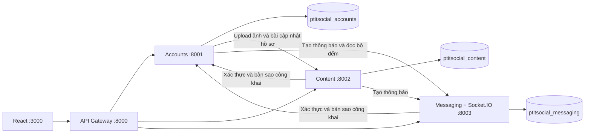

# Kiến trúc PTITSocial

## Quyền sở hữu

| Dịch vụ   | Dữ liệu được ghi                           | Nhiệm vụ                                                                |
| --------- | ------------------------------------------ | ----------------------------------------------------------------------- |
| Accounts  | `users`, `friends`, `follows`              | Tài khoản, mật khẩu, xác minh email, hồ sơ, tìm kiếm và quan hệ kết nối |
| Content   | `posts`, `comments`, `reactions`, file ảnh | Bảng tin, bài viết, tương tác và ảnh hồ sơ/bài viết                     |
| Messaging | `chats`, `messages`, `notifications`       | Hội thoại, tin nhắn, thông báo và trạng thái online                     |

Gateway chỉ chuyển request, không có model Mongoose và không truy cập database. Dịch vụ dùng thư viện kỹ thuật chung nhưng không import controller/model thuộc dịch vụ khác.

Thông báo được ghép vào Messaging vì cùng phục vụ giao tiếp thời gian thực ở quy mô bài tập lớn. Accounts gồm cả kết bạn và theo dõi để giữ một chủ sở hữu cho thông tin kết nối. Đây là ranh giới nghiệp vụ của phiên bản hiện tại, không phải một dịch vụ cho từng trang giao diện.

## Bản sao phục vụ đọc

Content và Messaging có collection `user_projections`: chỉ chứa ID, tên, username, ảnh, giới tính và trạng thái xác minh/công khai cần thiết để hiển thị. Không chứa email, mật khẩu, token khôi phục, token xác minh hoặc lịch sử tìm kiếm.

Content còn có `follow_projections` để tạo bảng tin. Hai collection này được cập nhật từ `GET /internal/projections` của Accounts trước khi xử lý request. Các request đồng thời trong cùng dịch vụ dùng chung một lượt đồng bộ đang chạy.

Các model projection không dùng schema tài khoản đầy đủ. Chúng chỉ đọc bản sao thông tin hồ sơ; các bộ đếm tin nhắn/thông báo trong Messaging do chính Messaging quản lý.

Cách pull snapshot phù hợp với lượng người dùng nhỏ trên localhost và giúp giữ các phép `populate` hiện có. Đây là một giới hạn về quy mô: mỗi lượt lấy snapshot đọc toàn bộ người dùng/quan hệ. Khi có nhiều người dùng, thay bằng sự kiện có version và outbox, hoặc API lấy theo danh sách ID. Không coi snapshot hiện tại là cơ chế phân phối dữ liệu cho hệ thống lớn.

## Xác thực và giao tiếp

- Người dùng tiếp tục dùng cookie/JWT qua Gateway. Accounts là nơi xác minh token, người dùng còn tồn tại, thời điểm đổi mật khẩu và trạng thái xác minh email.
- Content/Messaging gọi Accounts qua HTTP để xác thực. Việc sửa cookie giao diện không vượt được kiểm tra backend.
- Các API `/internal/*` đòi `x-service-key`; Gateway không công khai các đường dẫn này. Dịch vụ local chỉ lắng nghe `127.0.0.1`.
- Thay ảnh đại diện: Accounts gọi Content lưu ảnh, cập nhật hồ sơ mình sở hữu, rồi yêu cầu Content tạo bài cập nhật ảnh.
- Thích/bình luận/kết bạn: dịch vụ sở hữu thao tác gọi Messaging tạo thông báo. Messaging lưu và phát thông báo vào room người nhận.
- WebSocket được Gateway chuyển đến Messaging. Server lấy danh tính từ token, kiểm tra thành viên chat và kiểm tra tin nhắn đã lưu trước khi chuyển đến người nhận.

## Giới hạn và lỗi giữa các dịch vụ

Phiên bản này dùng HTTP đồng bộ, chưa dùng RabbitMQ/Kafka hay outbox. Nếu Content/Messaging ngừng khi một thao tác đã ghi dữ liệu ở dịch vụ khác, thao tác có thể hoàn thành một phần; chưa có transaction phân tán hoặc retry bền vững. Cần xem log, kiểm tra trạng thái thật trước khi gửi lại thao tác. Đây là hạn chế cần ghi rõ khi thuyết trình, không gọi là xử lý sự kiện bảo đảm giao hàng.

Gateway trả `503` khi không gọi được dịch vụ đích. `/health` của Gateway kiểm tra cả ba dịch vụ. Login vẫn có thể hoạt động khi Messaging tạm dừng; bộ đếm được trả về 0 và ghi log cảnh báo trong trường hợp đó.

## Chuyển dữ liệu và khôi phục

`scripts/migrate-legacy.cjs` giữ nguyên các ID để liên kết cũ vẫn đúng, không ghi đè bản ghi mới đã tồn tại và không sửa database `backbook`. JWT secret local cũ được giữ khi tạo cấu hình lần đầu để phiên đăng nhập hiện có không bị mất chỉ vì đổi kiến trúc.

Các file backend cũ nằm trong `legacy/backbook-server`. Không chạy bản cũ cùng Gateway vì trùng cổng 8000. Database cũ là mốc sao lưu tại thời điểm chuyển; các thao tác mới không tự ghi ngược về đó.

Metadata Git của hai checkout gốc được giữ trong `.local-backups/repositories/`. Thư mục gốc dùng một repository Git cho monorepo trên nhánh `main`; các thư mục con không còn là repository lồng nhau.
