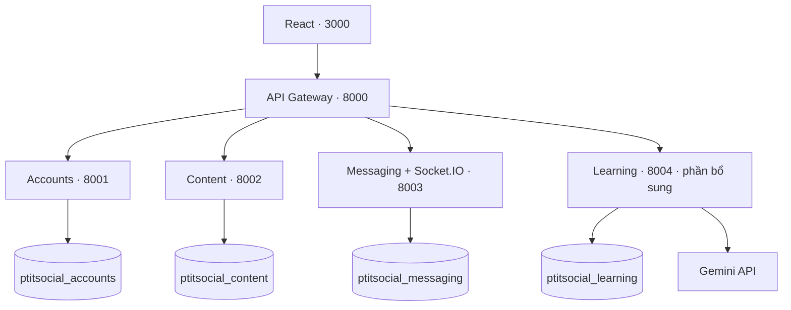
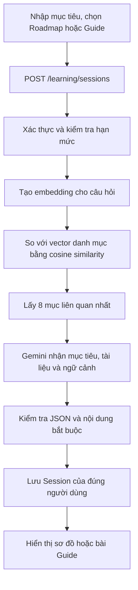

# Học và trình bày PTITSocial: BASE → Roadmap → Learn with AI

Tài liệu này dựa trên code hiện tại và README tại tag `BASE`. Hai chức năng riêng được nói tới ở đây là **Roadmap thường** và **Learn with AI**; Khế là phần hỏi đáp trong Learn with AI. Game đã được gỡ.

## 1. Cách mở đầu trong khoảng một phút

> Project của em là PTITSocial, một mạng xã hội dành cho sinh viên. Phần nền tảng có tài khoản, hồ sơ cá nhân, kết bạn, bài viết, bình luận và nhắn tin. Frontend dùng React; backend dùng Node.js và Express; dữ liệu lưu trong MongoDB. Backend được chia theo nghiệp vụ và đi qua một API Gateway.
>
> Trên phần nền đó, em tích hợp góc học tập gồm hai chức năng. Roadmap thường cung cấp sáu lộ trình dựa trên các nguồn roadmap.sh đã chọn, cho phép xem sơ đồ và lưu tiến độ cá nhân. Learn with AI dùng Gemini để tạo lộ trình hoặc hướng dẫn theo mục tiêu người dùng và hỗ trợ hỏi tiếp theo ngữ cảnh.

Nói rõ phần nền được kế thừa từ code nhóm và nguồn tham khảo Backbook ghi trong README. Khi giới thiệu phần đóng góp, chỉ vào các file và hành vi mình thực sự hiểu, đã chỉnh sửa hoặc tích hợp. `BASE` là tên mốc Git đã lưu trước khi thêm phần học tập, không phải tên một framework.

## 2. Những kiến thức cần học trước

| Thứ tự | Kiến thức | Cần tự giải thích được | Đọc trong project |
|---|---|---|---|
| 1 | HTML, CSS, JavaScript | Thẻ giao diện, bố cục, sự kiện click, mảng/object, hàm, import/export, Promise và async/await | Một component đơn giản trong `apps/web/src/pages/` |
| 2 | React | Component nhận props, state làm giao diện thay đổi, useEffect làm việc với hệ thống bên ngoài, render danh sách cần key | `apps/web/src/pages/learning/Roadmaps.jsx` |
| 3 | HTTP, API và JSON | Trình duyệt gửi request tới URL; method, body, status và response là gì | `services/gateway/src/routes.js` |
| 4 | Node.js, Express | Node chạy JavaScript ở server; Express định nghĩa route và middleware | `services/learning/src/server.js` |
| 5 | MongoDB, Mongoose | Document, collection, ObjectId; schema và truy vấn find/findOneAndUpdate | `services/learning/src/models.js` |
| 6 | Xác thực và phân quyền | Đăng nhập xác định ai đang gọi; phân quyền kiểm tra người đó được làm gì | `packages/service-kit/src/auth.js` |
| 7 | Lưu và tải state | Phân biệt state giao diện, dữ liệu server và dữ liệu bền vững trong DB | React Query trong trang Learning; Redux trong `apps/web/src/app/` |
| 8 | Realtime | Socket.IO chuyển sự kiện đến các client đang kết nối; DB vẫn lưu tin nhắn | `services/messaging/src/utils/socket.js` |
| 9 | AI qua API | Backend gửi ngữ cảnh tới dịch vụ mô hình, nhận kết quả và kiểm tra dữ liệu | `services/learning/src/provider.js` |
| 10 | Embedding và RAG | Vector biểu diễn nội dung, tìm các mục gần nghĩa rồi bổ sung vào yêu cầu cho Gemini | `services/learning/src/retrieval.js` |

Với `async/await`, hãy hiểu ví dụ: `await axios.get(...)` đợi kết quả của lời gọi đó trước khi chạy các dòng tiếp theo trong hàm. Trong lúc chờ mạng, giao diện có thể hiển thị trạng thái đang tải. Đừng giải thích rằng `await` làm toàn bộ website ngừng xử lý mọi người dùng.

### Các công nghệ dễ nhầm

- **React:** xây giao diện bằng component. **Node.js:** môi trường chạy JavaScript ở backend. **Express:** thư viện định nghĩa HTTP route/middleware chạy trên Node.
- **MongoDB:** hệ quản trị cơ sở dữ liệu. **Mongoose:** thư viện trong Node giúp mô tả schema, kiểm tra và truy vấn MongoDB.
- **Redux:** state dùng chung của giao diện như tài khoản, theme, trạng thái popup. **React Query:** tải, cache và cập nhật dữ liệu lấy từ server. **MongoDB:** giữ dữ liệu sau khi tải lại trang hay khởi động lại ứng dụng.
- **Git:** quản lý phiên bản source. **GitHub:** nơi lưu repository và phối hợp nhóm. **Docker Compose:** trong cấu hình local hiện tại dùng để chạy MongoDB và Mailpit; các tiến trình Node/React được script local khởi động riêng.

## 3. Giải thích phần BASE

### 3.1. Kiến trúc

Tại mốc BASE có ba dịch vụ nghiệp vụ: Accounts, Content và Messaging, cộng API Gateway. Khi thêm góc học tập, có thêm Learning.

Gateway chuyển request tới đúng dịch vụ. Ví dụ `/api/v1/posts/...` tới Content; `/api/v1/learning/...` tới Learning. Gateway không tự lưu bài viết và không trực tiếp kết nối MongoDB.

Một MongoDB local đang phục vụ các database tách biệt theo dịch vụ; không phải mỗi dịch vụ có một máy MongoDB vật lý riêng. Content và Messaging có bản sao thông tin hồ sơ công khai để hiển thị tên/ảnh. Việc đồng bộ đi qua API nội bộ của Accounts, không truy vấn trực tiếp database Accounts từ các dịch vụ đó.

Có thể gọi đây là backend chia theo dịch vụ nghiệp vụ trong một monorepo. Code nằm chung repository nhưng mỗi dịch vụ có entrypoint và trách nhiệm riêng. Bản localhost chưa có đầy đủ cơ chế vận hành của một hệ thống phân tán quy mô lớn.

### 3.2. Đăng nhập

Luồng cần hiểu:

1. React nhận email/mật khẩu từ form và gọi API đăng nhập.
2. Gateway chuyển yêu cầu tới Accounts.
3. Accounts tìm tài khoản và so sánh mật khẩu nhập với giá trị băm bằng bcrypt.
4. Đăng nhập hợp lệ thì server tạo JWT. Client dùng token/cookie khi gọi các API tiếp theo.
5. Middleware backend xác thực token, tài khoản và kiểm tra yêu cầu xác minh email ở những chức năng cần thiết.

Mật khẩu được **băm**, không phải lưu văn bản thuần rồi so sánh trực tiếp. JWT thông thường có chữ ký để phát hiện sửa đổi; payload không mặc nhiên là dữ liệu được mã hóa bí mật. Token hợp lệ cũng chưa có nghĩa được đọc mọi dữ liệu: còn phải kiểm tra quyền sở hữu hoặc thành viên.

Mailpit ở cổng 8025 là hộp thư thử nghiệm local để xem email xác minh/khôi phục, không phải một dịch vụ gửi email Internet cho môi trường production.

### 3.3. Ví dụ đăng bài

> Khi người dùng bấm Đăng, React gửi nội dung và chế độ người xem tới API. Gateway chuyển tới Content. Backend xác thực tài khoản, kiểm tra dữ liệu, lưu bài viết trong MongoDB rồi trả kết quả để giao diện cập nhật.

Các chế độ `public`, `friends`, `selected` tương ứng công khai, bạn bè, bạn bè được chọn. Quyền được kiểm tra ở backend. Với `selected`, người xem phải nằm trong danh sách cho phép và vẫn là bạn của tác giả; chủ bài có quyền xem bài của mình. API bài viết của ứng dụng yêu cầu đăng nhập và xác minh, nên “công khai” trong luồng này không đồng nghĩa mọi khách chưa đăng nhập đều xem được.

Đọc `services/content/src/utils/postAccess.js` để giải thích một kiểm tra quyền cụ thể. Ẩn nút trên React không thay thế được việc kiểm tra API.

### 3.4. Ví dụ chat realtime

1. Client gửi tin nhắn qua API.
2. Messaging kiểm tra người gửi thuộc cuộc trò chuyện và lưu tin nhắn.
3. Sau khi API thành công, client phát sự kiện chứa tin nhắn đã lưu.
4. Socket server kiểm tra tin nhắn và danh tính người gửi trước khi chuyển tới người nhận.
5. Người nhận cập nhật giao diện khi nhận sự kiện; lịch sử vẫn có thể đọc lại từ DB.

Socket.IO giúp nhận tin mà không phải tải lại trang. Nó không thay thế MongoDB. Với chat nhóm, đã đọc phải lưu theo từng thành viên: một người đọc không được làm mất bộ đếm chưa đọc của người khác.

## 4. Chức năng riêng thứ nhất: Roadmap thường

### Bài nói khoảng một phút

> Chức năng này hỗ trợ sinh viên chọn một lộ trình có sẵn và theo dõi tiến độ. Em sử dụng dữ liệu chủ đề và tài liệu từ sáu roadmap.sh đã xác định. Dữ liệu được kiểm tra và lưu thành snapshot JSON trong backend. Frontend dựng các node theo vị trí của sơ đồ nguồn, cho phép tìm kiếm, thu phóng, mở tài liệu và đánh dấu trạng thái học. Tiến độ được lưu trong MongoDB theo tài khoản và mã chủ đề, nên hai người học cùng roadmap có tiến độ riêng.

### Từ thao tác đến code

- **Dữ liệu gốc:** sáu URL AI Engineer, Cyber Security, Machine Learning, Python, SQL, C++.
- **Cập nhật dữ liệu:** `scripts/sync-roadmaps.py` đọc dữ liệu công khai từ trang và kho nội dung chính thức; lấy tên chủ đề, vị trí node, tài liệu từng mục và metadata nguồn.
- **Snapshot:** `services/learning/src/roadmap-data/*.json`; metadata lĩnh vực ở `roadmaps.js`. Việc đồng bộ được chạy chủ động, không tự truy cập roadmap.sh mỗi khi một người mở trang.
- **Tải roadmap:** `GET /api/v1/learning/roadmaps/python`.
- **Hiển thị:** `apps/web/src/pages/learning/Roadmaps.jsx`, phần `SourceDiagram` vẽ đường nối bằng SVG và node bằng nút HTML định vị theo tọa độ.
- **Lưu tiến độ:** `PATCH /api/v1/learning/roadmaps/:slug/topics/:topicId` với `{"status":"done"}`.
- **Dữ liệu tiến độ:** model `RoadmapProgress` chứa `user`, `roadmap`, `topics`. Trong `topics`, mỗi mã chủ đề ánh xạ tới chưa học/đang học/hoàn thành/bỏ qua.

Ví dụ dễ giải thích:

> Hai sinh viên cùng mở Python. Sinh viên A đánh dấu Decorators đã học. Backend lấy ID của A từ phiên xác thực và chỉ cập nhật bản ghi tiến độ của A. Khi B tải lại trang, API lấy tiến độ theo ID của B nên B không bị đánh dấu hoàn thành theo A.

Không yêu cầu API key cho việc đọc roadmap thường hoặc lưu tiến độ. Dữ liệu đọc là snapshot đã lưu, còn các bài giải thích đầy đủ/tài liệu bên ngoài được mở tại nguồn gốc. OWASP Top 10 chỉ thuộc mục tấn công web; tài liệu hệ điều hành lấy từ đúng mục Operating Systems, không gán một link chung cho cả nhóm.

Tiến độ dùng ID node nguồn có tiền tố `rs-`. Các mã số thứ tự của bộ dữ liệu cũ không được tự gán sang chủ đề mới để tránh đánh dấu nhầm kiến thức.

## 5. Chức năng riêng thứ hai: Learn with AI

### Bài nói khoảng một phút

> Người dùng nhập mục tiêu học tập và chọn Roadmap hoặc Guide. Backend xác thực tài khoản, tìm các mục liên quan trong danh mục học tập bằng embedding, rồi gửi mục tiêu, tài liệu tham khảo và ngữ cảnh sang Gemini. Với Roadmap, kết quả có các giai đoạn và nhiệm vụ để vẽ sơ đồ; với Guide, toàn bộ bài hướng dẫn nằm trong answer và được hiển thị bằng Markdown. Backend kiểm tra kết quả, lưu hội thoại theo người dùng và hỗ trợ hỏi tiếp ngay dưới bài hoặc qua chatbot Khế.

### Luồng xử lý cần vẽ lại được

Ở lần đầu hoặc khi danh mục đổi, hệ thống cần tạo embedding cho danh mục trước. Các lần sau dùng lại vector đã lưu.

### Embedding là gì?

Embedding biến văn bản thành một dãy số để mô hình hóa quan hệ nội dung. Trong cấu hình hiện tại, mỗi vector có 768 chiều. Không cần thuộc 768 số; cần hiểu mỗi tài liệu và câu hỏi được chuyển vào cùng không gian vector để so sánh.

Ví dụ, câu “Em muốn làm giao diện website” có thể gần các mục HTML/CSS/React dù không trùng hoàn toàn từ khóa trong tiêu đề. Tìm kiếm ngữ nghĩa có tính gần đúng, không bảo đảm mọi kết quả đều phù hợp.

`retrieval.js` tính **cosine similarity**, xếp hạng và lấy 8 mục đầu. Với kho nhỏ, việc so sánh đang làm trực tiếp trong Node.js; vector được lưu ở MongoDB. Code hiện tại không dùng Chroma, FAISS hay một vector database riêng, và chưa có bước reranker/ngưỡng liên quan bổ sung.

### RAG là gì trong project này?

RAG là bổ sung kết quả truy xuất vào yêu cầu tạo câu trả lời. Project tìm trong **danh mục cục bộ** gồm chủ đề, mô tả/tóm tắt và liên kết. Phần roadmap.sh mới được đưa vào catalog theo nhóm tên chủ đề. Project không tải và nhúng toàn văn mọi bài liên kết, cũng không tìm kiếm toàn bộ Internet theo thời gian thực.

Gemini vẫn có thể dùng kiến thức của mô hình để giải thích, kể cả khi tài liệu tham khảo chưa đủ. Vì vậy, phần tham khảo là ngữ cảnh hỗ trợ; không chứng minh từng câu AI nói đều đã xuất hiện trong nguồn. Đây là giới hạn cần nêu rõ khi được hỏi về độ chính xác.

### Tại sao có cache embedding?

Danh mục không đổi thì không cần nhúng lại mỗi lần. Code tạo mã băm từ nội dung, tên mô hình và cấu hình vector; nếu có index tương ứng trong MongoDB thì dùng lại. Khi đổi nội dung/mô hình, mã băm đổi và index được tạo lại. Đây là lưu kết quả tính toán, không phải huấn luyện hoặc fine-tune mô hình.

### Roadmap và Guide khác nhau ở dữ liệu nào?

| Chế độ | Kết quả chính | Cách hiển thị |
|---|---|---|
| Roadmap | `roadmap.title`, `summary`, `milestones`, `tasks` và `answer` | Sơ đồ và danh sách nhiệm vụ; lưu trạng thái hoàn thành |
| Guide | Toàn bộ bài trong `answer`; `roadmap` là `null` | Bài đọc Markdown, tiêu đề, danh sách, ví dụ code và nút copy |

Roadmap tạo mới đang có hồ sơ mặc định beginner, 8 tuần, 6 giờ/tuần trong request. Giao diện hiện không có form riêng để chỉnh ba trường này. Guide yêu cầu trả lời phù hợp câu hỏi, không ép một số mục cố định. Phần hiển thị không tự cắt câu trả lời để chỉ còn lời mở đầu.

### “Mỗi người có một AI riêng” nghĩa là gì?

Người dùng dùng chung dịch vụ Gemini mà backend cấu hình; ứng dụng tách mục tiêu và lịch sử theo tài khoản. Không tạo/huấn luyện một mô hình mới cho từng người. Khi hỏi tiếp, hệ thống gửi phần ngữ cảnh cần thiết của phiên đó.

- Ô chat dưới bài dùng `messages`.
- Khế dùng `assistantMessages` riêng và gửi `channel: "khe"`.
- Cả hai nhận bài/roadmap hiện tại làm ngữ cảnh nhưng không trộn hai lịch sử.
- Vị trí kéo thả của Khế lưu trong localStorage của trình duyệt, theo tài khoản; nội dung hội thoại lưu trên server.

### Dữ liệu và an toàn

`models.js` có:

- `Session`: người sở hữu, mục tiêu, chế độ, Guide/Roadmap và lịch sử.
- `RoadmapProgress`: tiến độ các roadmap thường.
- `EmbeddingIndex`: cache vector theo mã băm.
- `Usage`: bộ đếm sử dụng theo người/ngày.

API dùng ID từ tài khoản đã xác thực và truy vấn đồng thời `_id` của phiên cùng `user`. Biết ID phiên người khác không đủ để đọc/sửa nó.

API key Gemini nằm trong `.env` của backend Learning, không gửi xuống React. JWT xác định tài khoản của người dùng; API key xác thực lời gọi tới nhà cung cấp AI — chúng có hai vai trò khác nhau.

Hạn mức mặc định của ứng dụng là 5 yêu cầu tạo/hỏi mỗi phút và 30 lượt/người/ngày; quota của Google là giới hạn khác. `busyUntil` ngăn hai yêu cầu đồng thời ghi đè hội thoại. Backend kiểm tra JSON và nguồn tham khảo; Markdown renderer không thực thi HTML thô. Những việc này không bảo đảm AI luôn đúng về kiến thức.

## 6. Câu hỏi thầy có thể hỏi

| Câu hỏi | Cách trả lời ngắn, đúng code |
|---|---|
| Frontend với backend khác nhau thế nào? | React chạy giao diện; backend xác thực, xử lý nghiệp vụ và truy cập dữ liệu. |
| Tại sao dùng API Gateway? | Frontend gọi một địa chỉ API; Gateway chuyển theo đường dẫn tới dịch vụ sở hữu nghiệp vụ. |
| BASE có mấy dịch vụ? | Ba dịch vụ nghiệp vụ và Gateway. Hiện tại thêm Learning thành bốn dịch vụ nghiệp vụ. |
| Roadmap có phải AI tạo không? | Roadmap thường là snapshot theo nguồn đã chọn; Roadmap trong Learn with AI được Gemini tạo theo mục tiêu. |
| Dữ liệu roadmap lấy từ đâu? | Sáu URL roadmap.sh cụ thể; snapshot ghi nguồn, thời điểm và commit kho nội dung. |
| Tại sao lưu roadmap thành JSON? | Cho phép mở dữ liệu ổn định mà không phải gọi nguồn mỗi lượt; có thể kiểm tra phiên bản. Cần chủ động cập nhật khi nguồn thay đổi. |
| Tại sao MongoDB cần Mongoose? | Mongoose cung cấp schema, validation và cách truy vấn thuận tiện trong Node. Nó không phải database thứ hai. |
| Làm sao bảo vệ tiến độ cá nhân? | Backend lấy user từ phiên xác thực và luôn lọc dữ liệu theo user đó. |
| Tìm kiếm ngữ nghĩa khác tìm từ khóa ở đâu? | So sánh vector nội dung, thay vì chỉ kiểm tra có trùng chuỗi hay không. |
| Có tự huấn luyện AI không? | Không. Ứng dụng tích hợp Gemini và tạo embedding, truy xuất, quản lý ngữ cảnh cùng dữ liệu người dùng. |
| Tại sao dùng RAG khi Gemini đã biết nhiều thứ? | Bổ sung nguồn thuộc danh mục ứng dụng và tăng độ liên quan. Nó không loại bỏ mọi sai sót. |
| Có tìm Google trực tiếp khi hỏi không? | Không. Truy xuất trong catalog cục bộ; mô hình trả lời qua Gemini API. |
| Nếu thiếu API key hoặc hết quota? | API AI trả lỗi phù hợp; roadmap thường và tiến độ đã lưu vẫn dùng được khi backend/DB hoạt động. |
| AI có thể đánh dấu học xong thay người dùng không? | Hiện tại AI trả lời hướng dẫn. Việc lưu hoàn thành được thực hiện qua nút và API cập nhật tiến độ riêng. |
| Tại sao dùng JSON Schema? | Để yêu cầu cấu trúc có thể đọc bằng code; backend vẫn kiểm tra trước khi lưu/hiển thị. |
| Nếu hai người cùng học Python? | Cùng dữ liệu roadmap, khác bản ghi tiến độ và hội thoại theo user. |
| Khế khác ô hỏi tiếp thế nào? | Khác giao diện và lịch sử, cùng dùng ngữ cảnh bài đang mở và dịch vụ Gemini. |
| Có những giới hạn gì? | Chất lượng AI, quota, catalog chưa phải toàn văn, đồng bộ nguồn thủ công, thuật toán tìm kiếm/đồng bộ dịch vụ phù hợp quy mô local. |

## 7. Học theo sáu buổi

**Buổi 1 — JavaScript và React.** Hiểu object/array, map/filter, import/export, sự kiện, props/state, useEffect, async/await. Tự chỉ ra phần nhập mục tiêu và state đổi khi người dùng gõ. Viết thử một component nhỏ có input và nút hiển thị nội dung.

**Buổi 2 — HTTP và Express.** Mở DevTools → Network, xem một request roadmap. Đọc method, URL, status, JSON trả về; lần theo Gateway rồi route Learning. Tự giải thích GET đọc, POST tạo và PATCH cập nhật một phần trong các API này.

**Buổi 3 — MongoDB và quyền truy cập.** Đọc ba trường user/roadmap/topics của RoadmapProgress và các trường chính của Session. Tìm điều kiện `user: req.user.id`. Giải thích vì sao client không được tự chọn chủ sở hữu bằng body.

**Buổi 4 — BASE.** Kể lại luồng đăng nhập, đăng bài và gửi tin nhắn. Phân biệt HTTP lưu dữ liệu với Socket.IO phát sự kiện. Chỉ ra ba dịch vụ BASE và database của chúng.

**Buổi 5 — Roadmap thường.** Từ một node trên màn hình, tìm `sourceId` trong JSON; kiểm tra tài liệu của node; đánh dấu hoàn thành rồi quan sát PATCH trong Network. Đổi tài khoản để chứng minh tiến độ riêng.

**Buổi 6 — Learn with AI và diễn tập.** Vẽ lại luồng embedding → cosine → top 8 → Gemini → kiểm tra → lưu → hiển thị. Demo Guide, hỏi tiếp và Khế; tự trả lời mười câu trong bảng trên. Nói rõ giới hạn mà không đoán phần chưa đọc.

Nếu ít thời gian, ưu tiên một luồng hiểu thật sâu: **chọn một chủ đề → đánh dấu hoàn thành → API → DB → cập nhật giao diện**. Sau đó học luồng AI. Với mỗi phần, luôn trả lời bốn câu: người dùng làm gì, API nào nhận, server xử lý gì, lưu dữ liệu ở đâu.

## 8. Thứ tự demo khoảng 7–10 phút

1. Giới thiệu đề tài và phân biệt phần BASE với phần học tập bổ sung.
2. Chỉ sơ đồ kiến trúc. Mở nhanh một luồng BASE: đăng bài hoặc gửi tin nhắn.
3. Mở Cyber Security, chọn Operating Systems và chỉ ra đúng tài liệu; đánh dấu đang học.
4. Đổi tài khoản/trình duyệt, cho thấy tiến độ riêng.
5. Nhập một yêu cầu AI cụ thể, ví dụ “Giải thích con trỏ C++ cho người mới, có ví dụ”. Chọn Guide.
6. Mở câu trả lời, chỉ một code block; hỏi tiếp “Giải thích ví dụ đầu tiên”.
7. Mở Khế để minh họa hỏi theo ngữ cảnh và lịch sử riêng.
8. Mở `server.js`, `models.js`, `retrieval.js` và `provider.js` ở những đoạn đã học. Giải thích một request thay vì đọc nguyên file.
9. Kết thúc bằng kết quả đạt được và hai hướng cải thiện: mở rộng chất lượng truy xuất/nguồn dữ liệu, nâng cơ chế đồng bộ khi tăng quy mô.

Trước buổi trình bày, chạy thử hệ thống và kiểm tra quota Gemini. Có thể chuẩn bị sẵn một phiên AI đã lưu để trình bày dữ liệu khi mạng/quota có vấn đề; nói rõ đó là kết quả đã lưu, không phải câu trả lời vừa được tạo.

## 9. Những file nên mở sẵn

| Nội dung | File |
|---|---|
| Mốc nền tảng | `git show BASE:README.md` |
| Điều hướng frontend | `apps/web/src/routes/pagesData.jsx` |
| Chia request cho dịch vụ | `services/gateway/src/routes.js` |
| Xác thực dùng chung | `packages/service-kit/src/auth.js` |
| Đăng nhập | `services/accounts/src/controllers/authController.js` |
| Phân quyền bài viết | `services/content/src/utils/postAccess.js` |
| Realtime chat | `services/messaging/src/utils/socket.js` |
| Sơ đồ và tiến độ thường | `apps/web/src/pages/learning/Roadmaps.jsx` |
| Giao diện AI | `apps/web/src/pages/learning/index.jsx` |
| Đọc dữ liệu nguồn | `services/learning/src/roadmaps.js`, `roadmap-data/` |
| API học tập và kiểm tra chủ sở hữu | `services/learning/src/server.js` |
| Schema dữ liệu học tập | `services/learning/src/models.js` |
| Danh mục ngữ nghĩa | `services/learning/src/catalog.js` |
| Xếp hạng vector và cache | `services/learning/src/retrieval.js` |
| Gọi Gemini, schema kết quả | `services/learning/src/provider.js` |
| Khế | `apps/web/src/pages/learning/KheChat.jsx` |
| Markdown và code | `apps/web/src/pages/learning/GuideContent.jsx` |

Các kiểm tra có sẵn: `npm run test:architecture`, `npm run test:learning`, `node tests/learning-integration.cjs` khi các dịch vụ đang chạy, kiểm thử frontend và `npm run build:web`. Unit test kiểm tra hàm/luật cụ thể; integration test kiểm tra nhiều phần làm việc cùng nhau. Test dùng provider giả lập để chạy ổn định không chứng minh mọi câu trả lời Gemini thật đều đúng.

## 10. Giải thích khóa API dự phòng

Backend Learning có thể đọc nhiều khóa Gemini trong cấu hình riêng. Khi Google trả lỗi 429 cho khóa đang dùng, backend tạm ngừng dùng khóa đó và thử khóa tiếp theo. Khóa còn hoạt động được ưu tiên cho lượt kế tiếp. Cả embedding và tạo nội dung dùng cơ chế này.

Đây là xử lý dự phòng và backoff, không phải tăng token bằng code. Các khóa cùng Google Cloud project vẫn có thể chung hạn mức. Nếu toàn bộ khóa đang bị giới hạn, API trả lỗi để người dùng thử lại sau; không gửi yêu cầu vòng lặp vô hạn. Giới hạn sử dụng theo tài khoản trong ứng dụng là một tầng riêng.
